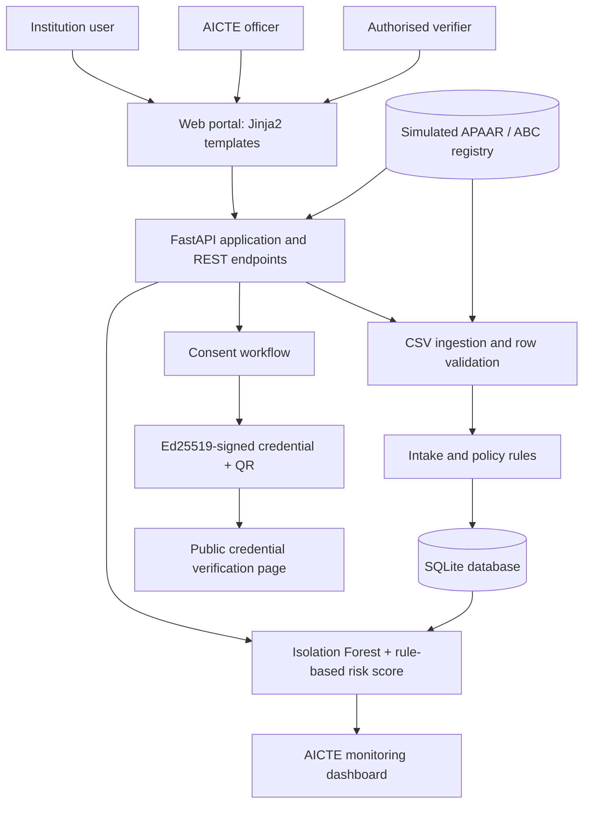

# APAAR Pramaan

**APAAR ID–Based Student Data Management & Verification Platform**
**Smart India Hackathon 2026 · Problem Statement 26263 · Smart Automation**

<p align="center">
  <a href="https://apaar-pramaan.onrender.com/">
    
  </a>
</p>

**Live Application:** https://apaar-pramaan.onrender.com/

APAAR Pramaan is a hackathon prototype for managing student-level enrolment records across AICTE-approved institutions. It demonstrates how institution uploads, APAAR-format checks, enrolment validation, compliance monitoring, consent-based record disclosure, and verifiable credentials can be brought together in one web application.

> **Prototype notice:** This project is an independent demonstration and is not an official AICTE, APAAR, ABC, DigiLocker, or Government of India service. The APAAR/ABC registry is simulated with local demonstration data. No live government integration is included. Use only synthetic data when running or demonstrating this repository.

## Contents

* [Live Demo](#live-demo)
* [Problem addressed](#problem-addressed)
* [Key features](#key-features)
* [Application workflow](#application-workflow)
* [Architecture](#architecture)
* [Technology stack](#technology-stack)
* [Repository structure](#repository-structure)
* [Run locally on Windows](#run-locally-on-windows)
* [Demo accounts](#demo-accounts)
* [REST API](#rest-api)
* [Security mechanisms in the prototype](#security-mechanisms-in-the-prototype)
* [Current scope and limitations](#current-scope-and-limitations)
* [Potential next steps](#potential-next-steps)

## Live Demo

The hosted prototype is available at:

**[Launch APAAR Pramaan](https://apaar-pramaan.onrender.com/)**

The application allows evaluators to explore the student data management and verification workflows through a web interface.

The application is hosted on Render's free web-service tier. The service may take some time to respond after a period of inactivity. Database changes and generated files may not persist across service restarts or redeployments.

**Demonstration guidelines:**

* Use synthetic student records only.
* Do not enter real APAAR IDs or confidential student information.
* The identity registry and consent OTP are simulated.
* The application is a technical prototype, not a production student-record system.

## Problem addressed

The project responds to **SIH 2026 Problem Statement 26263**: *Development of an APAAR ID-Based Student Data Management and Verification Platform for AICTE-Approved Institutions.* The intended workflow in the problem statement calls for institution-level student data submission, validation, monitoring, and authorised verification.

APAAR Pramaan demonstrates that workflow with synthetic records. It is intended to make common data-quality and enrolment issues visible to institutions and administrators, while providing a consent step before a verifier receives a signed student-record credential.

## Key features

### Institution portal

* Upload student enrolment data in CSV format.
* Validate records row by row and show accepted, updated, warning, and rejected outcomes.
* Check APAAR ID format and lookup against the **simulated local registry**.
* Detect duplicate IDs in an upload and potential enrolment in another institution.
* Flag identity mismatches, missing or invalid dates of birth, ages below 16, missing student IDs, quota-category conflicts, missing approved intake, and enrolment beyond approved intake plus supernumerary seats.
* Add or update an individual student record using a registry lookup.
* View the seat matrix and student list, and generate a printable certificate with a QR code.

### AICTE administrator dashboard

* View aggregated enrolment metrics and institution-level dashboards.
* Highlight programmes whose enrolment exceeds the configured intake limit.
* Review institution compliance-risk scores and the reasons contributing to those scores.
* Inspect potential cross-institution duplicate enrolments and search records.
* View the audit-chain status and export a CSV compliance report.

### Authorised verifier portal

* Request consent before releasing enrolment information.
* In the demonstration, confirm consent using an OTP displayed in the application.
* Issue an Ed25519-signed credential containing a limited set of student/enrolment claims.
* Generate a QR code that opens a public credential-verification page.

### Additional capabilities

* English, Hindi, and Tamil interface text.
* Session-based role separation for institution, AICTE, and verifier demonstration users.
* REST API endpoints for student uploads, AICTE risk results, and credential verification.
* Synthetic seed data for demonstrations, including deliberately injected data-quality issues.

## Application workflow

1. An institution signs in and uploads student-level data.
2. The application validates the rows against policy rules and the local mock APAAR registry.
3. Accepted records are stored; warning and rejection reasons are returned for review.
4. The AICTE dashboard aggregates institution and enrolment information, including intake and anomaly indicators.
5. An authorised verifier requests a record and completes the prototype consent step.
6. The application issues a signed credential with a QR code; the public page checks the credential signature and reports whether it is valid.

## Architecture



The diagram describes the current prototype, not a deployed national architecture. The live APAAR/ABC, DigiLocker, NAD, and AICTE integrations are not connected.

## Technology stack

| Layer                | Technology                                       | Purpose in this project                                                               |
| -------------------- | ------------------------------------------------ | ------------------------------------------------------------------------------------- |
| Web framework        | FastAPI, Uvicorn                                 | Web routes and REST API                                                               |
| UI                   | Jinja2, HTML, CSS                                | Role-based web pages and printable views                                              |
| Local data store     | SQLite, SQLAlchemy                               | Demo institutions, enrolments, registry entries, consent records, and audit events    |
| Data processing      | pandas                                           | CSV processing and dashboard/report calculations                                      |
| Anomaly scoring      | scikit-learn `IsolationForest` plus policy rules | Prototype institution-level compliance-risk score                                     |
| Application security | `cryptography`                                   | AES-GCM field encryption, password hashing helpers, and Ed25519 credential signatures |
| QR generation        | `qrcode[pil]`                                    | QR codes for verification links                                                       |
| Languages            | English, Hindi, Tamil                            | Localised interface strings                                                           |
| Hosting              | Render                                           | Public demonstration deployment                                                       |
| Version control      | Git, GitHub                                      | Source-code management                                                                |

The risk score is a prototype prioritisation signal, not a validated regulatory decision system. The Isolation Forest output is combined with rule-based indicators such as intake overshoot, late admissions, invalid IDs, and duplicate records; the displayed reasons are intended to help a human reviewer understand the flags.

## Repository structure

```text
apaar-pramaan/
├── README.md
├── .gitignore
├── requirements.txt
└── backend/
    ├── main.py               # FastAPI routes and application entry point
    ├── services.py           # Validation, dashboards, risk scoring, credentials and audit logic
    ├── models.py             # SQLAlchemy models and SQLite configuration
    ├── security.py           # Encryption, HMAC, and password-hash helpers
    ├── i18n.py               # English, Hindi, and Tamil strings
    ├── seed_data.py          # Synthetic demo-data generator
    ├── static/
    │   ├── style.css
    │   └── img/
    └── templates/            # Jinja2 portal pages
```

The database, generated secret-key files, demo-ID files, upload samples, and report exports are local runtime artifacts and should not be committed.

## Run locally on Windows

### Prerequisites

* Windows 10/11
* Python 3.10 or newer
* Git (only needed to clone or contribute to the repository)
* PowerShell or the VS Code integrated terminal configured for PowerShell

### 1. Clone the repository

```powershell
git clone https://github.com/amosjebastin-j/apaar-pramaan.git
cd apaar-pramaan
```

### 2. Create and activate a virtual environment

```powershell
py -m venv .venv
Set-ExecutionPolicy -Scope Process -ExecutionPolicy Bypass
.\.venv\Scripts\Activate.ps1
```

### 3. Install dependencies

```powershell
python -m pip install --upgrade pip
pip install -r requirements.txt
```

### 4. Create or reset the synthetic demonstration data

```powershell
cd backend
python seed_data.py
```

This creates the local SQLite demonstration database, a mock APAAR registry, demo users, and generated sample files. **Running `seed_data.py` resets/recreates the demonstration dataset.** Run it when you intentionally want a fresh demonstration; do not rerun it if you need to retain records entered during a session.

On first application startup, the application also seeds the database automatically if the database file does not exist.

### 5. Start the application

Run this from the `backend` directory:

```powershell
python -m uvicorn main:app --reload
```

Open these addresses in your browser:

* **Portal:** http://127.0.0.1:8000
* **Demo guide:** http://127.0.0.1:8000/demo-guide
* **Interactive REST API documentation:** http://127.0.0.1:8000/api/docs

Keep the terminal running while using the application. Press `Ctrl+C` to stop the development server.

## Demo accounts

These accounts are created by the synthetic seed script. They are for local demonstrations only.

| Role                          | Username   | Password    |
| ----------------------------- | ---------- | ----------- |
| AICTE officer                 | `aicte`    | `aicte123`  |
| Institution nodal officer     | `inst001`  | `inst123`   |
| Verifier (employer/regulator) | `employer` | `verify123` |

The demonstration uses synthetic student records. The seeded APAAR IDs are written to `backend/demo_apaar_ids.txt` after data generation and are intentionally excluded from Git.

These demo credentials are publicly documented and must not be used to protect real student information. Do not enter real student information into the hosted application.

## REST API

The interactive API documentation is available at `/api/docs` while the server is running.

* **Local API documentation:** http://127.0.0.1:8000/api/docs
* **Hosted API documentation:** https://apaar-pramaan.onrender.com/api/docs

| Method | Endpoint                                          | Purpose                                               | Access in this prototype                             |
| ------ | ------------------------------------------------- | ----------------------------------------------------- | ---------------------------------------------------- |
| `POST` | `/api/v1/students/upload`                         | Upload a CSV and return row-level validation outcomes | HTTP Basic authentication; institution role required |
| `GET`  | `/api/v1/institutions/risk`                       | Return institution risk results                       | HTTP Basic authentication; AICTE role required       |
| `GET`  | `/api/v1/credentials/verify?token=<signed-token>` | Verify a signed credential and return its claims      | Public verification endpoint                         |

The CSV upload endpoint expects a multipart file upload. Refer to `/api/docs` for request schemas and interactive testing.

## Security mechanisms in the prototype

The code demonstrates the following mechanisms in a local proof of concept:

* **AES-256-GCM:** Encrypts APAAR ID and student-name fields stored through the model's encrypted string type.
* **HMAC-SHA256:** Creates a keyed identifier for lookup and duplicate matching without using the raw APAAR ID as the lookup key.
* **PBKDF2-HMAC-SHA256:** Hashes demonstration passwords with a per-password salt.
* **Ed25519:** Signs issued credential payloads; the public verification route checks the signature.
* **Hash-chained audit log:** Links audit entries so changes to prior entries can be detected by the audit-chain check.
* **Role checks and sessions:** Separate institution, AICTE, and verifier portal access.

These mechanisms are educational prototype implementations and are not a claim of production security certification or regulatory compliance. Before real deployment, the system requires independent security review, secure secret management and key rotation, hardened authentication, rate limiting, operational monitoring, database and backup controls, privacy/legal review, and end-to-end testing.

## Current scope and limitations

The following boundaries are important when evaluating or extending the project:

* **Mock identity source:** The APAAR/ABC registry is a local SQLite table populated with synthetic records. No official APAAR, ABC, DigiLocker, NAD, or AICTE API is called.
* **Simulated consent delivery:** The consent OTP is displayed in the demonstration UI; it is not delivered through a production SMS, email, or identity-provider service.
* **Demonstration authentication:** The project includes seeded demo accounts and is not configured for public production use.
* **Local database:** SQLite is used for the prototype. On Render's free hosting tier, local database changes and generated files may not persist across restarts or redeployments.
* **Planned production integrations:** SFTP/webhooks, live government registry connections, multi-factor authentication, production identity federation, and scheduled PDF/accreditation reporting are not implemented as live production services in this repository.
* **Risk model:** The Isolation Forest and policy thresholds are demonstration logic. They need representative, authorised data, evaluation, monitoring, fairness review, and human oversight before any operational use.

## Potential next steps

1. Obtain formal authorisation and technical specifications for official APAAR/ABC and relevant institutional integrations.
2. Introduce production-grade identity federation, multi-factor authentication, a real consent-delivery workflow, key management, and audited access policies.
3. Move to a production database and deployment architecture with migrations, observability, backups, and automated tests.
4. Evaluate and calibrate the anomaly-detection model using authorised, representative data, with explanations and a human-review process.
5. Add institution ERP adapters, controlled bulk-transfer options, scheduled reports, and accessibility/security testing.

## License

No open-source license is currently included. Unless a license is added, reuse and redistribution are not expressly granted. Add a suitable `LICENSE` file before publishing the project for unrestricted reuse.
